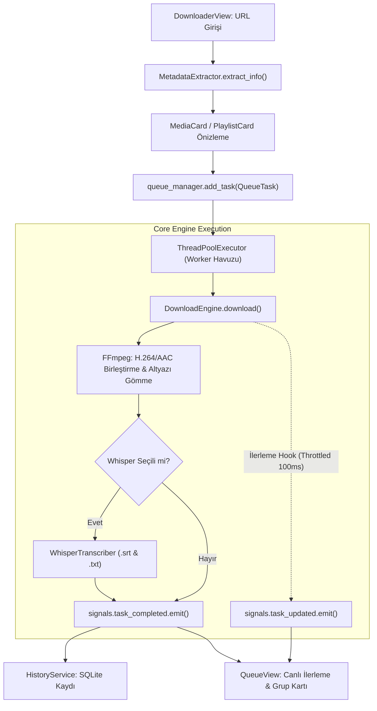

# StreamScribe — Mimari ve Sistem Tasarımı

Bu doküman, **StreamScribe** v3.1.0'ın katmanlı mimarisini, veri akışını, eşzamanlı görev yönetimini ve bileşenler arası iletişim modelini açıklar.

---

## 🏛️ Katmanlı Mimari Şeması

```text
Streamscribe/
├── src/                        # Tüm uygulama kaynak kodları
│   ├── core/                   # İş mantığı, yt-dlp ve Whisper motoru
│   │   ├── engine.py           # yt-dlp indirme motoru ve H.264/AAC format kontrolü
│   │   ├── metadata.py         # Video/oynatma listesi metadata analiz motoru
│   │   ├── queue_manager.py    # Thread-pool eşzamanlı kuyruk yöneticisi & Qt Signals
│   │   ├── transcriber.py      # Whisper yerel transkripsiyon motoru
│   │   └── ffmpeg_helper.py    # Yerel ve sistem FFmpeg tespiti ve yardımcıları
│   ├── services/               # Servisler ve kalıcı veri katmanı
│   │   ├── config_service.py   # JSON tabanlı kalıcı ayarlar (~/.streamscribe/streamscribe_settings.json)
│   │   ├── history_service.py  # SQLite tabanlı indirme geçmişi (~/.streamscribe/history.db)
│   │   └── logger.py           # Yapılandırılmış ve döngüsel loglama servisi
│   ├── ui/                     # PySide6 (Qt) arayüz katmanı
│   │   ├── app.py              # Ana pencere ve navigasyon sidebar'ı
│   │   ├── styles.py           # Modern Dark Theme QSS (Slate 900 paleti)
│   │   ├── components/         # MediaCard, PlaylistCard, QueueItemWidget, PlaylistGroupWidget
│   │   └── views/              # DownloaderView, QueueView, HistoryView, SettingsView
│   ├── config.py               # Uygulama sabitleri ve yapılandırma
│   └── legacy/                 # Eski sürümlerden arşivlenen kodlar
├── ffmpeg/                     # Taşınabilir yerel FFmpeg ikilileri
├── logo/                       # İkon ve görsel varlıklar
├── releases/                   # Derlenmiş hazır EXE sürümleri
├── docs/                       # Geliştirici ve kullanıcı dokümantasyonu
├── main.py                     # Temiz PySide6 giriş noktası
├── requirements.txt            # Bağımlılık listesi
└── build.py                    # Standalone EXE derleme betiği
```

---

## 🔄 Veri ve Sinyal Akışı (Workflow)



---

## ⚡ Kritik Mühendislik Standartları

1. **Deadlock Önleme (Re-entrant RLock):**
   `QueueManager` kilit mekanizmasında `threading.RLock()` kullanılır. Sinyaller (`signals.*.emit()`) ASLA kilit bloğunun (`with self._lock:`) içinde tetiklenmez.
2. **GUI Event Throttling:**
   `yt-dlp` indirme ilerleme hook'u arayüze saniyede en fazla 10 kez (100 ms sınırlandırmasıyla) iletilir. Bu sayede Qt event döngüsü daima akıcı kalır.
3. **Evrensel Codec Standardı:**
   Standart Windows oynatıcılarının (Filmler ve TV / Windows Media Player) ek codec gerekmeden oynatabilmesi için video formatı H.264 (AVC) + AAC olarak zorlanır.
4. **Hata Toleranslı Altyazı Fallback'i:**
   Altyazı indirilirken YouTube 429 Too Many Requests verirse veya altyazı yoksa indirme iptal edilmez; motor otomatik olarak `embed_subs=False` ile videoyu başarıyla indirmeye devam eder.
